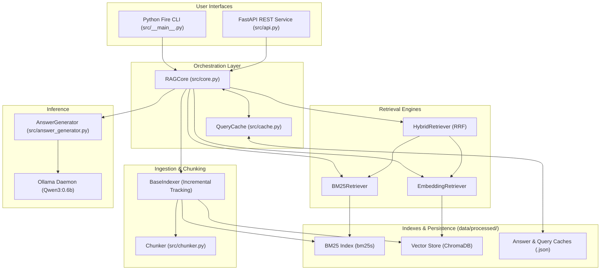

*This project has been created as part of the 42 curriculum by psewasti.*

# RAG Against the Machine

A modular, local Retrieval-Augmented Generation (RAG) system built to index and query large-scale
codebases and technical documentation, targeting the [vLLM](https://github.com/vllm-project/vllm)
repository. The system pairs language-aware text chunking with lexical, semantic, and hybrid
retrieval engines, feeding retrieved contexts into a locally hosted small language model
(`Qwen/Qwen3-0.6B`, served through Ollama) to answer developer questions accurately and concisely.

```
       ┌────────────────┐
       │   Developer    │
       │  Query / API   │
       └───────┬────────┘
               │
               ▼
      ┌─────────────────┐       ┌────────────────────────┐
      │   Query Cache   │──────►│ Cached Answer / Search │
      └────────┬────────┘ (Hit) └────────────────────────┘
               │ (Miss)
               ▼
      ┌─────────────────────────────────────────────────┐
      │               Retrieval Pipeline                │
      │  ┌───────────────────┐   ┌───────────────────┐  │
      │  │   Lexical BM25    │   │  Dense Embedding  │  │
      │  │  (Lucene scoring) │   │ (all-minilm:l6-v2)│  │
      │  └─────────┬─────────┘   └─────────┬─────────┘  │
      │            └──────────┬────────────┘            │
      │                       ▼                         │
      │           Reciprocal Rank Fusion (RRF)          │
      └───────────────────────┬─────────────────────────┘
                              │
                              ▼ Top-k Chunks
      ┌─────────────────────────────────────────────────┐
      │            Answer Generation Engine             │
      │    (Local Ollama Engine: Qwen/Qwen3-0.6B)       │
      └───────────────────────┬─────────────────────────┘
                              │
                              ▼
                     Synthesized Response
```

---

## Description

**RAG Against the Machine** addresses the challenge of navigating and querying complex codebases
without relying on external cloud APIs or closed proprietary models. Given a repository containing
thousands of source code and markdown documentation files (the vLLM codebase under `data/raw/`), the
system parses, segments, indexes, and queries these resources on local consumer hardware.

The primary objective is to achieve high retrieval accuracy (measured by **Recall@k**) and produce
concise, factual answers to technical queries, while maintaining an extensible software architecture
that complies with strict typing, linting, and performance constraints.

---

## System Architecture

The project follows a clean facade architecture centered around `RAGCore`, decoupling business logic
from CLI commands and HTTP endpoints.



### Component Breakdown

1. **`src/chunker.py` (`Chunker`)**: Segments source files according to language syntax rules,
   tracking exact character offsets (`first_character_index`, `last_character_index`).
2. **`src/indexers/` (`Indexer`, `BM25Indexer`, `EmbeddingIndexer`, `HybridIndexer`)**: Builds and
   maintains inverted lexical indices and vector databases under `data/processed/<max_chunk_size>/`.
   Implements incremental delta detection against cached file modification timestamps.
3. **`src/retriever.py` (`BM25Retriever`, `EmbeddingRetriever`, `HybridRetriever`)**: Executes
   single and batch queries across indices, normalizing and ranking retrieved chunks.
4. **`src/answer_generator.py` (`AnswerGenerator`)**: Extracts source text slices from disk and
   constructs structured prompts passed to Ollama's streaming generation endpoint.
5. **`src/cache.py` (`QueryCache`)**: Manages partitioned search results and global answer caches,
   avoiding redundant computation for repeated queries.
6. **`src/core.py` (`RAGCore`)**: Central controller encapsulating the entire lifecycle (indexing,
   retrieval, answering, and evaluation).
7. **`src/__main__.py` & `src/api.py`**: Presentation adapters exposing `RAGCore` via CLI
   subcommands and RESTful HTTP endpoints.

---

## Chunking Strategy

Standard fixed-size chunking often severs function signatures, breaks class definitions, or divides
markdown tables midway. This project adopts a language-aware splitting strategy using LangChain's
`RecursiveCharacterTextSplitter`.

### 1. Language-Specific Boundaries

- **Python (`Language.PYTHON`)**:
    - Splits recursively on language syntax delimiters: `\nclass `, `\ndef `, `\n\tdef `, followed
      by line breaks and spaces.
    - Chunk overlap: 10% of `max_chunk_size` (`max_chunk_size // 10`).
    - Preserves cohesive function bodies and class hierarchies.
- **Markdown (`Language.MARKDOWN`)**:
    - Splits recursively on heading hierarchy (`# `, `## `, `### `, `#### `), blockquotes, lists,
      and paragraphs.
    - Chunk overlap: 5% of `max_chunk_size` (`max_chunk_size // 20`).
    - Keeps section headings coupled with their explanatory paragraphs.

### 2. Contextual Metadata Enrichment

To prevent chunks from losing their architectural context within deep repository hierarchies, each
chunk's content is prefixed with its relative path and file basename during chunking:

```
File: vllm/engine/llm_engine.py
File: llm_engine.py

class LLMEngine:
    ...
```

This ensures that queries searching for specific files or module-level classes match immediately
during lexical and semantic passes.

### 3. Exact Character Span Tracking

To satisfy evaluation criteria, chunks record their exact zero-indexed start and end character
offsets in the original raw source file:

- `first_character_index`: Start offset of the raw document slice.
- `last_character_index`: End offset (`first_character_index + len(content)`).

---

## Retrieval Method & Ranking Mechanism

The system supports three retrieval methods selectable via `--method` (default: `lexical`):

### 1. Lexical Retrieval (`lexical`)

- **Engine**: Implemented via `bm25s` with Lucene scoring parameters:
    - $k_1 = 1.5$ (term frequency saturation)
    - $b = 0.9$ (document length penalization)
    - $\delta = 0.5$ (lower-bound term weight)
- **Preprocessing**: Cleans input strings, strips control characters, lowercases tokens, and
  normalizes punctuation.
- **Strengths**: Excels at retrieving exact identifier names, class signatures, CLI argument flags,
  and specific technical keywords.

### 2. Semantic Vector Retrieval (`embedding`)

- **Engine**: Persistent ChromaDB vector database using the HNSW index algorithm with cosine
  distance (`metadata={"hnsw:space": "cosine"}`).
- **Embedding Model**: `all-minilm:l6-v2` served locally through Ollama.
- **Strengths**: Excels at conceptual, intent-driven queries where the user phrasing differs from
  the exact terminology used in the codebase.

### 3. Hybrid Retrieval (`hybrid`)

Hybrid retrieval merges candidates from both the BM25 and dense vector retrievers using **Reciprocal
Rank Fusion (RRF)**:

$$RRF (d) = \sum_{m \in \{BM25, Embedding\}} \frac{1}{k_{rrf} + \text{rank}_m (d)}$$

where $k_{rrf} = 60$ (standard smoothing constant).

```
BM25 Candidates (Top 2k)      ──┐
                                ├─► Reciprocal Rank Fusion (RRF) ─► Top-k Final Sources
Vector Candidates (Top 2k)    ──┘
```

1. Each retriever queries its respective index for $2 \times k$ candidate items.
2. The candidates are merged, calculating a unified score based on rank positions rather than
   uncalibrated raw scores.
3. The combined list is sorted in descending order of RRF score, taking the top $k$ items.

---

## Performance Analysis

System evaluation measures **Recall@k** against ground-truth datasets
(`data/datasets/AnsweredQuestions/`). A retrieved source counts as relevant if it is in the same
file as a ground-truth source and their character ranges overlap with an Intersection over Union
(IoU) of at least `0.05`.

### Benchmark Results

**Target (applies to lexical method only):**

- **Documentation (`docs`)**: $\ge 80.0\%$ Recall@5
- **Codebase (`code`)**: $\ge 50.0\%$ Recall@5

| Retrieval Method | Model                     | Docs Recall@5 [%] | Code Recall@5 [%] |
|:-----------------|:--------------------------|:-----------------:|:-----------------:|
| **Lexical**      | BM25                      |       `84`        |       `80`        |
| **Embedding**    | `all-minilm:l6-v2`        |       `70`        |       `47`        |
| **Hybrid**       | BM25 + `all-minilm:l6-v2` |       `85`        |       `72`        |

*Note: Retrieved contexts are subsequently passed to `Qwen/Qwen3-0.6B` via Ollama for answer
generation.*

### Latency and Indexing Performance

Measured on a CPU workstation with full cold-start wipes (`max_chunk_size=2000`, $k=5$, 1,969 raw
files / 14,635 chunks):

| Metric                                          | Lexical (BM25) | Embedding (`all-minilm`) | Hybrid (RRF) | Subject Target |
|:------------------------------------------------|:--------------:|:------------------------:|:------------:|:--------------:|
| **Cold Index Build Time**                       |    `1.56s`     |          `142s`          |    `144s`    |  $\le 5$ min   |
| **Cold Retrieval Throughput (199 questions)**   |      `1s`      |           `4s`           |     `5s`     |   $\le 90$s    |
| **Cached Retrieval Throughput (199 questions)** |      `1s`      |           `1s`           |     `1s`     |   $\le 90$s    |
| **Cold Answer Generation Latency**              |      `3s`      |           `3s`           |     `3s`     |       —        |
| **Cached Answer Latency (Answer Hit)**          |    `< 5ms`     |         `< 5 ms`         |   `< 5ms`    |       —        |

- **Corpus Indexing**: Both BM25 (`1.56s`) and ChromaDB vector indexing (`142.90s` from scratch)
  execute well below the 5-minute threshold.
- **Retrieval Throughput**: Evaluating the full public test dataset (199 questions) completes in
  `1s` (Lexical), `4s` (Embedding), and `5s` (Hybrid), drastically outperforming the subject
  constraint of $\le 90$s for 200 questions.

### Effect of Chunk Size on Recall@k

Lexical (BM25) retrieval, $k=5$:

| `max_chunk_size` | Docs Recall@5 [%] | Code Recall@5 [%] |
|:-----------------|:-----------------:|:-----------------:|
| `2000`           |        84         |        80         |
| `1500`           |        84         |        77         |
| `1000`           |        85         |        75         |
| `500`            |        82         |        72         |

Docs recall barely changes with chunk size (82–85%), peaking at `1000` and only dropping slightly at
`500`. Markdown sections are usually short and self-contained, so smaller chunks still keep a
heading together with its explanation. Code recall, on the other hand, drops steadily as chunks get
smaller (80% → 72%). Smaller chunks are more likely to split a function or class away from its
signature, docstring, and surrounding identifiers, which removes the terms BM25 needs to match the
question. `2000` gives the best overall balance and is kept as the default.

---

## Design Decisions

- **Modular Indexer/Retriever Abstraction**: Base classes (`Indexer` and `Retriever`) define unified
  contracts. Adding new vector databases or embedding algorithms requires zero changes to core CLI
  or API logic.
- **Partitioned Disk Storage**: Indexes and caches under `data/processed/` are partitioned by chunk
  size, retrieval method, and embedding model, while generated answers are kept in a global answer
  cache. This cleanly isolates third-party library files from application metadata and query caches.
- **Model Flexibility & Cache Separation**: The models used for both embedding (default:
  `all-minilm:l6-v2`) and answer generation (default: `Qwen3:0.6b`) can be changed for other models,
  and caching will continue to work correctly because index and search caches are strictly isolated
  and partitioned by model identifier. However, swapping models is not recommended: the current
  models offer a well-tuned compromise between latency and quality. Using larger or more complex
  models would take too much time on 42 machines.
- **Strict Pydantic Validation**: All data exchanged across stages (`ChunkData`, `MinimalSource`,
  `MinimalSearchResults`, `StudentSearchResults`, `StudentSearchResultsAndAnswer`) is validated
  through immutable Pydantic models.
- **Local-First & CPU Capable**: By leveraging `bm25s`, lightweight ChromaDB storage, and Ollama
  with small models (`Qwen/Qwen3-0.6B`, `all-minilm:l6-v2`), the entire pipeline runs reliably on
  standard CPU-only machines.
- **Graceful Error Handling & Fallbacks**: Service connection drops (such as Ollama availability)
  are intercepted cleanly, reporting actionable diagnostics rather than unhandled tracebacks.

---

## Challenges Faced

1. **Low Recall@5 Scores**:
    - *Challenge*: Initial retrieval passes yielded low Recall@5 scores.
    - *Solution*: Added context (file name and relative path) directly to each chunk, and split
      camelCase and snake_case identifiers into individual words.
2. **Slow Embedding Time and Huge Dependencies**:
    - *Challenge*: Computing embeddings locally within the Python environment resulted in slow
      embedding times and required bulky dependencies.
    - *Solution*: Delegated embedding generation to a local Ollama daemon, drastically cutting down
      dependency overhead and improving embedding throughput.

---

## Bonus Features

All five bonus objectives from Chapter IX of the subject are fully implemented:

| Bonus Feature               | Description                                               | Implementation                                                            |
|:----------------------------|:----------------------------------------------------------|:--------------------------------------------------------------------------|
| **1. Semantic Embeddings**  | Vector index built with lightweight CPU model             | ChromaDB with `all-minilm:l6-v2` via Ollama (`src/indexers/embedding.py`) |
| **2. Hybrid Retrieval**     | Lexical + semantic rankings combined into one list        | Reciprocal Rank Fusion (RRF) with $k=60$ (`src/retriever.py`)             |
| **3. Incremental Indexing** | Re-indexes only modified files rather than entire dataset | File `mtime` delta tracking & selective upsert (`src/indexers/base.py`)   |
| **4. Caching**              | Cache index, search results, and generated answers        | Partitioned search cache & global answer cache (`src/cache.py`)           |
| **5. Local HTTP API**       | REST API exposing index querying and answer generation    | FastAPI service with `/search` and `/answer` endpoints (`src/api.py`)     |

---

## Instructions

### Requirements

- **Python**: `>= 3.13`
- **Package Manager**: [uv](https://github.com/astral-sh/uv)
- **Build Utilities**: `make`

### Installation

Install project dependencies:

```bash
make install
```

### Available Makefile Targets

| Target               | Description                                     | Example / Default                                       |
|:---------------------|:------------------------------------------------|:--------------------------------------------------------|
| `make install`       | Synchronize virtual environment with `uv`       | `make install`                                          |
| `make run`           | Execute the main CLI entrypoint                 | `make run ARGS="--help"`                                |
| `make index`         | Build search index for specified method         | `make index METHOD=lexical MAX_CHUNK_SIZE=2000`         |
| `make search`        | Run a single query search                       | `make search QUERY="What is vLLM?" METHOD=hybrid K=5`   |
| `make answer`        | Query the system and generate an LLM answer     | `make answer QUERY="How does PagedAttention work?" K=5` |
| `make search-docs`   | Batch search across docs dataset                | `make search-docs METHOD=lexical`                       |
| `make search-code`   | Batch search across code dataset                | `make search-code METHOD=lexical`                       |
| `make answer-docs`   | Generate answers for docs search results        | `make answer-docs`                                      |
| `make answer-code`   | Generate answers for code search results        | `make answer-code`                                      |
| `make evaluate-docs` | Evaluate Recall@k against ground-truth docs     | `make evaluate-docs`                                    |
| `make evaluate-code` | Evaluate Recall@k against ground-truth code     | `make evaluate-code`                                    |
| `make api`           | Launch local FastAPI server with uvicorn        | `make api`                                              |
| `make debug`         | Run CLI under Python debugger (`pdb`)           | `make debug`                                            |
| `make lint`          | Run strict `flake8` and `mypy` checks           | `make lint`                                             |
| `make test`          | Run test suite via `pytest`                     | `make test`                                             |
| `make clean`         | Remove virtual environment and cached artifacts | `make clean`                                            |

---

## Example Usage

### 1. Building the Search Index

Build the lexical BM25 index:

```bash
uv run python -m src --method=lexical index --max_chunk_size=2000
```

Or build the semantic embedding index:

```bash
uv run python -m src --method=embedding index --max_chunk_size=2000
```

### 2. Querying the Search Index (CLI)

Perform a top-5 hybrid search for a technical query:

```bash
uv run python -m src --method=hybrid search "How does PagedAttention manage KV cache?" --k=5
```

Sample JSON Output:

```json
{
  "question_id": "97e099a8-e160-4966-9b55-6b83f324d5ba",
  "question": "How does PagedAttention manage KV cache?",
  "retrieved_sources": [
    {
      "file_path": "data/raw/vllm-0.10.1/vllm/v1/core/kv_cache_manager.py",
      "first_character_index": 1240,
      "last_character_index": 2890
    },
    {
      "file_path": "data/raw/vllm-0.10.1/docs/design/paged_attention.md",
      "first_character_index": 350,
      "last_character_index": 1820
    }
  ]
}
```

### 3. Generating Answers (CLI)

Retrieve context and synthesize an answer using the local language model:

```bash
uv run python -m src --method=hybrid answer "What is the purpose of LLMEngine in vLLM?" 5
```

Sample Output:

```
The LLMEngine class is the core execution coordinator in vLLM, responsible for continuous batching, managing worker ranks, scheduling sequences, and interfacing with the model runner.
```

### 4. Running Dataset Batch Search, Evaluation & Answering (CLI)

Search a whole dataset (output directory scoped by dataset):

```bash
uv run python -m src --method=lexical search_dataset \
  --dataset_path data/datasets/UnansweredQuestions/dataset_docs_public.json \
  --k 10 \
  --save_directory data/output/search_results/UnansweredQuestions
```

Evaluate recall@k against the ground-truth dataset:

```bash
uv run python -m src evaluate \
  --student_search_results_path data/output/search_results/UnansweredQuestions/dataset_docs_public.json \
  --dataset_path data/datasets/AnsweredQuestions/dataset_docs_public.json
```

Generate answers from the search results:

```bash
uv run python -m src answer_dataset \
  --student_search_results_path data/output/search_results/UnansweredQuestions/dataset_docs_public.json \
  --save_directory data/output/search_results_and_answer/UnansweredQuestions
```

The same pipeline is available through Makefile shortcuts:

```bash
make search-docs METHOD=hybrid
make evaluate-docs
make answer-docs
```

### 5. Running the Local HTTP REST API

Start the server:

```bash
make api
```

*(Server listens on `http://127.0.0.1:8000`)*

Query via `curl`:

```bash
# Search endpoint
curl -G "http://127.0.0.1:8000/search" \
  --data-urlencode "query=What is PagedAttention?" \
  --data-urlencode "k=5" \
  --data-urlencode "method=hybrid"

# Answer endpoint
curl -G "http://127.0.0.1:8000/answer" \
  --data-urlencode "query=What is PagedAttention?" \
  --data-urlencode "k=3" \
  --data-urlencode "method=hybrid"
```

---

## Resources

- [BM25s Documentation & GitHub](https://github.com/xhluca/bm25s) — High-performance lexical
  retrieval implementation in Python.
- [ChromaDB Documentation](https://docs.trychroma.com/) — Open-source embedding database.
- [Reciprocal Rank Fusion (RRF)](https://plg.uwaterloo.ca/~gvcormac/cormacksigir09-rrf.pdf) —
  Cormack, Clarke, and Buettcher (SIGIR '09).
- [LangChain Recursive Character Text Splitter](https://python.langchain.com/docs/how_to/recursive_text_splitter/) —
  Language-aware splitting documentation.
- [Ollama API Documentation](https://github.com/ollama/ollama/blob/main/docs/api.md) — Local model
  serving API.
- [Qwen Model Family](https://github.com/QwenLM/Qwen3) — Technical specifications and overview of
  Qwen models.
- [FastAPI Framework](https://fastapi.tiangolo.com/) — High-performance modern web API framework for
  Python.

### AI Usage

AI assistants were used for the following tasks:

- **Explaining methods and design patterns**: Clarifying concepts before implementing them, such as
  caching strategies (search vs. answer caches, cache invalidation by chunk size and model),
  Reciprocal Rank Fusion (RRF) for hybrid retrieval, and the facade architecture used for `RAGCore`.
- **Code review**: Reviewing implemented modules for bugs, edge cases, `flake8`/`mypy` compliance,
  and conformity with the subject requirements.
- **Writing the README**: Helping structure and phrase this documentation, and checking that it
  covers every section the subject requires.
- **Testing**: Writing automated tests, suggesting edge cases.
